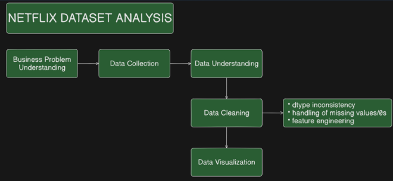

# Netflix-Dashboard-Minor-Project
Using Power BI

## WORKFLOW

## PROBLEM STATEMENT
1. Which was the best movie and TV show overall in the last 50 years?
2. How many movies do we have in our dataset across the last few years? Do we have more representation of movies from the last 20 years, or is the dataset free from any such skewness?
3. On average, how has the IMDb score been trending over the last 50 years? Has it been deteriorating or improving?
4. Have more people started voting for movies/shows on IMDb over the last 50 years?
5. On average, how has the runtime changed over the last 50 years?
6. How does age certification of a movie affect its rating?

## DATA COLLECTION
Dataset is downloaded from a publicly available resource.

## DATA UNDERSTANDING
* id: A unique count of this ID would be useful while calculating and understanding trends. Example: The number of movies released in 2020 would simply be a unique count of the ID field.
* release_year: At the outset, it seems that it includes movies from 1953 to 2022, i.e. 70 years of data. But on closer inspection, we notice that some years are missing e.g. 1955, 1957.
* title: The dataset becomes very interesting as many of the titles can be recognized.
* type: If we use the FILTER option in Excel to see the different TYPE values that are there, we will see two: MOVIE and SHOW.
* description: Although for our analysis, description may not be very important, but we can extract keywords out of it and use machine learning to extract information like the genre of the movie/show.
* age_certification: Something to note here is that in many cases age certification is missing. We may want to handle missing values separately in some cases, but here since there is no effective way to substitute this missing information, we will leave it as is for our analysis.
* runtime: Although it is not mentioned, it is clear that runtime is in minutes. One should see the range of values, visualize the distribution and if required, handle outliers in this field.
* imdb_score: This is the IMDb rating of the movie/show. This tells us how well the movie was rated by the voters.
* imdb_votes: This is the number of people who voted on IMDb for a movie or show. It is important to recognize that this leads to a lot of subjectivity because if very few people have voted for a movie/show its imdb_score will not be very reliable.

The dataset has 5283 records, and this data includes both movies and shows.

## DATA CLEANING
1. Changed datatype of columns from mixed to standard datatypes.
2. Null Handling:
* age_certification: Insert a step after clicking fx at top to find mode using List.Mode(List.RemoveNulls(#"Changed Type"[age_certification])) in Power Query Editor (or can see Column Value Distribution after setting Column Profiling to entire dataset too). Delete this step after mode is known. Now, use mode to replace null values.
* imdb_votes: Replace 1 null value with 0 (representing no votes).
3. Apply filter to select all rows (optional).
4. Error Handling: Replace zeroes in runtime column with the average of column values.
5. Feature Engineering: Create a new column "overall_ratings" multiplying imdb_score and imdb_votes.

## DATA VISUALIZATION
### DAX Expressions
1. Mode Age Certification = 
MINX (
    TOPN (
        1,
        ADDCOLUMNS (
            VALUES(Netflix[age_certification]),
            "Frequency", CALCULATE(COUNT(Netflix[age_certification]))
        ),
        [Frequency],
        DESC
    ),
    Netflix[age_certification]
)
2. Average Runtime = AVERAGE(Netflix[runtime])
### Reports
Created a page with KPI plots for DAX measures, a page with all visuals related to problem statement and another page with a text box containing all insights.
### Dashboard
Pinned Report 2 and 3 to the dashboard in Power BI Service.
